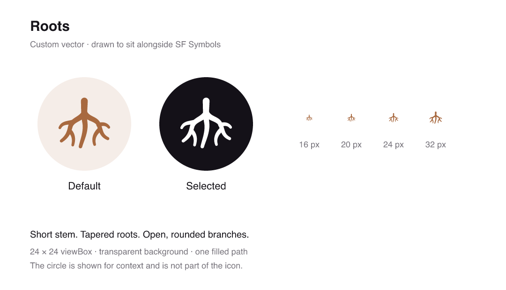

# SproutSymbols

Botanical icons for SwiftUI, delivered as native custom SF Symbols. Starting with **roots**.



## Installation

In Xcode, choose **File → Add Package Dependencies**, enter
`https://github.com/LiamSx45/SproutSymbols`, and select version **1.0.0** or later.
Add the **SproutSymbols** library to your app target.

Or add it to a Swift package:

```swift
dependencies: [
    .package(url: "https://github.com/LiamSx45/SproutSymbols.git", from: "1.0.0")
]
```

Then add `.product(name: "SproutSymbols", package: "SproutSymbols")` to your target's dependencies.

Requires Swift 6.2 or later. Supports iOS 16+ and macOS 13+.

## Usage

```swift
import SwiftUI
import SproutSymbols

Image(sprout: .roots)
    .font(.title2.weight(.semibold))
    .imageScale(.large)
    .foregroundStyle(.brown)
```

Or use `SproutSymbol.roots.image`.

The icons use native symbol assets, so font weight, symbol scale, and tint work through standard SwiftUI modifiers. Semantic fonts adapt to Dynamic Type. The roots symbol is monochrome with three interpolation masters: Ultralight, Regular, and Black. It does not include separate color layers or draw-animation annotations.

For a labeled control:

```swift
Button(action: showRootCare) {
    Label {
        Text("Root care")
    } icon: {
        Image(sprout: .roots)
    }
}
```

The standalone image has the accessibility label “Roots”. Override `.accessibilityLabel(...)` for a specific meaning or localized wording. Use `.accessibilityHidden(true)` for a purely decorative image.

## Available symbols

| Symbol | SwiftUI | SVG |
| --- | --- | --- |
| Roots | `Image(sprout: .roots)` | [Recolorable](SVG/roots.svg) · [Brown](SVG/roots-brown.svg) |

The SVGs have transparent backgrounds. The circles in the preview are presentation only.

## Package contents

The library contains Swift code and the icon asset catalog, with no external dependencies. SVG downloads, previews, documentation, and resource tests are included in the repository but are not bundled into your app. Design-generation scripts are kept separately.

Use Xcode to build and test the package, so the asset catalog is compiled:

```sh
xcodebuild -scheme SproutSymbols -destination 'platform=macOS' test
```

Resources load through `Bundle.module`, following [Apple's package resource guidance](https://developer.apple.com/documentation/xcode/bundling-resources-with-a-swift-package). The icon format follows [Apple's custom symbol guidance](https://developer.apple.com/documentation/technologyoverviews/creating-custom-sf-symbols).

## License

The original code and custom icon artwork are available under the [MIT license](LICENSE). SproutSymbols is an independent project and is not affiliated with Apple.
