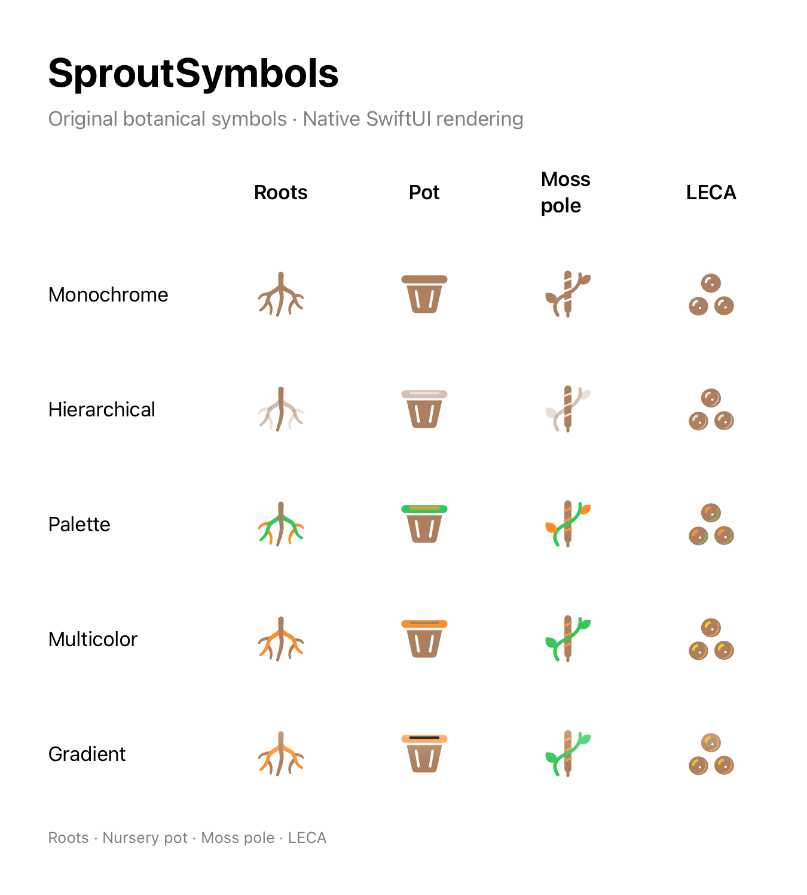

# SproutSymbols

Original botanical icons for SwiftUI, delivered as native custom SF Symbols. Includes **roots, nursery pot, moss pole, and LECA**.



## Installation

In Xcode, choose **File → Add Package Dependencies**, enter
`https://github.com/LiamSx45/SproutSymbols`, and select version **1.1.0** or later.
Add the **SproutSymbols** library to your app target.

Or add it to a Swift package:

```swift
dependencies: [
    .package(url: "https://github.com/LiamSx45/SproutSymbols.git", from: "1.1.0")
]
```

Add `.product(name: "SproutSymbols", package: "SproutSymbols")` to your target's dependencies.
Requires Swift 6.2+, iOS 16+ or macOS 13+. No external dependencies.

## Usage

```swift
import SwiftUI
import SproutSymbols

Image(sprout: .roots)
    .font(.title2.weight(.semibold))
    .imageScale(.large)
    .symbolRenderingMode(.monochrome)
    .foregroundStyle(.brown)
```

`SproutSymbol.roots.image` is a shorthand for the same image. Assets load from the package bundle; use this initializer instead of `Image(systemName:)`.

## Available symbols

| Symbol | Swift case | SVG downloads |
| --- | --- | --- |
| Branching roots | `.roots` | [Recolorable](SVG/roots.svg) · [Multicolor](SVG/roots-multicolor.svg) · [Brown](SVG/roots-brown.svg) |
| Nursery pot | `.pot` | [Recolorable](SVG/pot.svg) · [Multicolor](SVG/pot-multicolor.svg) |
| Moss / coir support pole | `.mossPole` | [Recolorable](SVG/moss-pole.svg) · [Multicolor](SVG/moss-pole-multicolor.svg) |
| LECA clay pebbles | `.leca` | [Recolorable](SVG/leca.svg) · [Multicolor](SVG/leca-multicolor.svg) |

Plain SVG downloads use a transparent 24 × 24 canvas. Their colors are portable SVG colors; native assets use adaptive system colors. SF-specific layers and variable rendering are in the asset catalog's annotated SVGs.

## Rendering modes

All four icons have separate primary, secondary, and tertiary layers:

```swift
Image(sprout: .mossPole)
    .symbolRenderingMode(.hierarchical)
    .foregroundStyle(.green)

Image(sprout: .mossPole)
    .symbolRenderingMode(.palette)
    .foregroundStyle(.brown, .green, .orange)

Image(sprout: .mossPole)
    .symbolRenderingMode(.multicolor)
```

Omit `symbolRenderingMode` to use SwiftUI's automatic mode. The package leaves that choice to the surrounding view. Monochrome uses one foreground style, hierarchical varies emphasis, palette uses up to three supplied styles, and multicolor uses the artwork's system colors. The pot's opening uses the foreground tint in multicolor mode.

| Symbol | Primary | Secondary | Tertiary |
| --- | --- | --- | --- |
| Roots | Main root | Branches | Fine roots |
| Pot | Body | Rim | Opening |
| Moss pole | Support | Vine | Leaves and wrapping |
| LECA | Pebbles | Edge shading | Porous highlights |

### Variable color

```swift
Image(sprout: .leca, variableValue: 0.5)
    .symbolRenderingMode(.monochrome)
    .foregroundStyle(.brown)
```

Pass a value from `0...1` to emphasize three successive layer groups; omit the value to show the complete icon normally. Use values such as `0`, `0.5`, and `1` to preview the stages. This is **variable color**, not a continuous change to the geometry or Variable Draw.

Roots emphasize the main root, branches, then fine roots. The moss pole emphasizes the support, vine, then leaves. LECA emphasizes successive pebbles. The pot emphasizes its body, opening, then rim. These are visual stages, not calibrated measurements of plant health, moisture, or fullness. Provide a text value when communicating progress.

### Native gradients

Requires iOS 26+ / macOS 26+ and an SDK that includes this API. The package's minimum OS stays unchanged.

```swift
if #available(iOS 26, macOS 26, *) {
    Image(sprout: .leca)
        .symbolRenderingMode(.multicolor)
        .symbolColorRenderingMode(.gradient)
} else {
    Image(sprout: .leca)
        .symbolRenderingMode(.multicolor)
}
```

## Capability coverage

| Capability | Status |
| --- | --- |
| Automatic, monochrome, hierarchical, palette, multicolor | Supported on every symbol |
| Font size and weight, image scale, semantic fonts / Dynamic Type | Supported; Ultralight, Regular, and Black interpolation masters |
| Variable color | Three stages on every symbol, iOS 16+ / macOS 13+ |
| Native color gradients | Supported, iOS 26+ / macOS 26+ |
| Standard `symbolEffect` modifiers | Native `Image` API; layered motion groups included. Use each effect's OS availability and respect Reduce Motion. |
| Draw On / Draw Off and Variable Draw | **Not authored yet**; path guide annotations are still required |
| Separate `.fill`, `.circle`, `.slash` variants | **Not included**; no automatic artwork variants are promised |

The library does not claim complete parity with every system symbol feature. Draw guides and additional artwork variants are separate authoring work; selecting a modifier does not create them.

## Accessibility

Use semantic fonts when icons should scale with text. Each image has a default accessible name: “Roots”, “Pot”, “Moss pole”, or “LECA”. Override it for the meaning of a control or your app's localization, and hide purely decorative images from accessibility.

```swift
Button(action: showRootCare) {
    Label {
        Text("Root care")
    } icon: {
        Image(sprout: .roots)
    }
}
```

Do not use color or animation as the only way to communicate state. The package adds no automatic animation or haptics.

## Development and validation

The public repository contains the Swift library, icon artwork, documentation, and resource tests. Python generators and design experiments are maintained separately and are not included in this repository or your app.

Use Xcode to compile the asset catalog when building or testing:

```sh
xcodebuild -scheme SproutSymbols -destination 'platform=macOS' test
```

Tests load every native asset, compare the four explicit rendering modes, verify three variable-color stages, and compare native gradient output. The annotated templates passed SF Symbols validation. Release 1.1.0 was tested with Xcode 27.1 on macOS and an iOS simulator; visual previews were inspected on iPhone SE and a larger iPhone. Minimum supported OS runtimes and physical devices were not available for this release's checks.

The format follows Apple's [custom symbol guidance](https://developer.apple.com/documentation/technologyoverviews/creating-custom-sf-symbols), [layer annotation format](https://developer.apple.com/documentation/technologyoverviews/annotating-custom-sf-symbols), and [SF Symbols design guidance](https://developer.apple.com/design/human-interface-guidelines/sf-symbols). Resources load through `Bundle.module`, following [Apple's package resource guidance](https://developer.apple.com/documentation/xcode/bundling-resources-with-a-swift-package).

## Planned additions

Pon, orchid bark, sphagnum, repot, perlite, pumice, charcoal, castings, and a disease / fungus symbol. These are not included in this release.

## License

Original code and custom icon artwork are available under the [MIT license](LICENSE). SproutSymbols is independent and is not affiliated with Apple.
